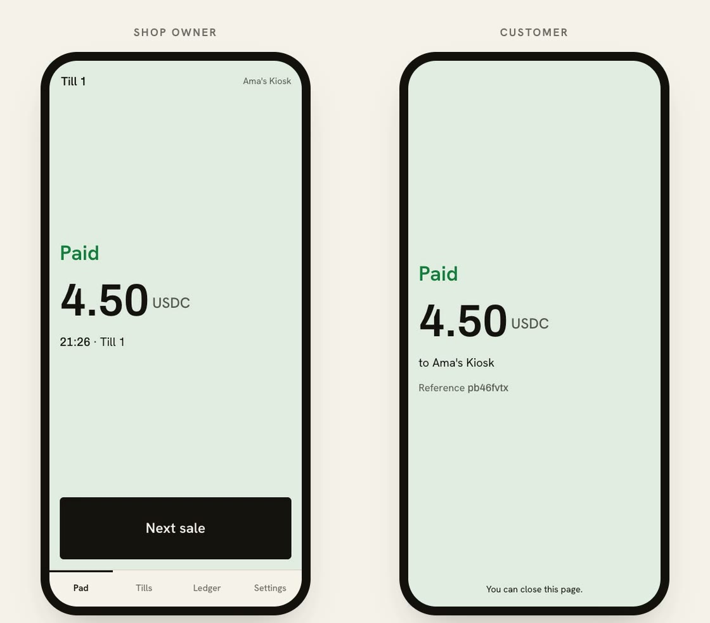

# Lane

Lane turns a phone into a shop's payment counter. The owner sets up with a fingerprint,
the customer scans a code and pays from their own wallet or straight from an exchange app,
and the money lands in the shop's own account on Monad. The shop never installs a wallet: the fingerprint
creates its accounts on the phone, through [Mera](https://mera.category.xyz/), Category Labs' passkey
library. Lane never holds a key or the money.

<p align="center"></p>
<p align="center"><sub>A real payment on Monad testnet, from the demo: the shop's phone showed Paid 0.8 seconds after the customer confirmed.</sub></p>

Built for Monad Metropolis, Consumer Products & Payments track.
Demo video: https://youtu.be/hfj2WTRs3-Y
Mera video (passkeys, signing sessions, encrypted records backup): https://youtu.be/K8bl6tCJ-64

## Live on Monad testnet

- App: https://lane-mu.vercel.app
- TillRegistry: `0xc4C275cA0E095aA7C6012C426E08f9bE27e718DB` (chain 10143)
- Token: Circle test USDC `0x534b2f3A21130d7a60830c2Df862319e593943A3`, verified on chain (USDC, 6 decimals)
- Every push to `main` deploys the app. `scripts/deploy-testnet.sh` deploys the registry and sets the public settings; the treasury key is added to Vercel by hand, never by script.

Measured on testnet, 8 Oct 2026, at about 103 gwei:

| Step | Gas | MON |
|---|---|---|
| Gas drip | 21,000 | 0.0022 |
| Register a till | 71,625 | 0.0074 |
| Customer pays USDC | 100,504 | 0.0104 |
| Sweep a till | 100,516 | 0.0103 |

The node at `wss://testnet-rpc.monad.xyz` serves live subscriptions.

## Built around Monad

- **One passkey, many keys, through Mera.** Mera runs the passkey ceremonies and returns the PRF output; Lane derives the shop's account and one per till from it, and every transaction signs through a Mera signing session that zeroes its key when the action ends.
- **The same passkey also encrypts.** The records that exist only on the owner's phone (what was sold, which payment matched which request) are backed up as a Mera secret vault: a PRF evaluation under its own fresh salt, never the account salt, keys AES-256-GCM on the phone. Lane's server stores a copy it cannot read, and a new phone restores it with the same passkey.
- **USDC or USDT, whichever the customer holds.** On mainnet a till accepts Circle's USDC and Tether's USDT0, counted as dollars one for one. A customer whose USDT sits on an exchange such as Bybit can withdraw it on the Monad network straight to the till, with no wallet and no MON for gas. Close the day moves each coin in its own transaction, and refunds go back in the coin that was paid, to an address the shop confirms.
- **Settlement before the customer walks away.** In the demo the shop's phone showed Paid 0.8 seconds after the customer confirmed.
- **No contract between customer and shop.** A payment is one plain USDC transfer into the till, so any wallet can pay with one signature and nothing can fail or need an approval in between.
- **Tills run in parallel.** Each till is its own account, and the only contract is a registry with no shared counters, so sales into different tills never touch the same state.
- **The reserve balance rule, handled.** Accounts stay undelegated; sweeps are batched per till, a repeat sweep inside two seconds is queued, and back-to-back sends from one account are spaced three blocks apart.
- **Exact gas, declared.** Monad charges the declared gas limit, so every transaction declares the estimate for that exact call.
- **Public endpoint limits.** Monad's public testnet endpoint serves logs over at most 100 blocks, so all history is read in 100-block spans and tills are restored by reading the registry directly.

## Layout

| Path | What |
|---|---|
| `contracts/` | Foundry. `TillRegistry.sol` (owner→till registry, no funds, no shared slots), `MockUSD.sol` (local chain only), deploy script, 10 tests. |
| `web/` | Next.js 16 app. All product code under `web/src`. |
| `web/src/lib/` | Technical core: `passkey.ts` (passkeys and PRF output via Mera), `accounts.ts` (BIP-44 derivation from the PRF output, Mera signing sessions), `request.ts` (payment requests carried in the link fragment, matching), `watch.ts` (websocket subscription with polling fallback and catch-up), `ledger.ts` (this device's records plus a recent chain scan, or the indexer; balances always from chain), `chain.ts` (config, 100-block history spans), `tx.ts` (explicit-gas sends, registration, per-till sweep with a two-second queue, refunds, same-sender pacing), `backup.ts` (records backup as a Mera secret vault), `shop.ts`, `staff.ts`, `storage.ts`. |
| `web/src/app/api/drip/route.ts` | Gas treasury: one-at-a-time sends, shared rate limits, 21,000 explicit gas. |
| `web/src/app/api/pair/` | Six-digit staff pairing codes: issue and one-time redeem, rate limited. |
| `web/src/app/api/backup/route.ts` | Encrypted records backups: stores Mera vaults it cannot read, replaced only with the phone's write token, rate limited. |
| `web/src/proxy.ts` | Strict content security policy with a per-request nonce; unknown paths go to `/`. |
| `indexer/` | Envio project (optional; app falls back to chain logs). |
| `scripts/dev-chain.sh` | Starts Anvil, deploys, writes `web/.env.local`. `scripts/pay.sh <till> <amount>` simulates a customer. |

## Screens

| Path | What |
|---|---|
| `/` | Landing page. Primary action reads "Start taking payments", or "Continue to your till" for a returning merchant. It never redirects. |
| `/start` | Cold open, passkey prompt, dismissed and unsupported-authenticator recovery, insecure-context refusal, shop setup with a non-blocking preparing line, and "I already have a shop" restore. |
| `/till` | Merchant home. Pad, request code, paid / paid short / overpaid / offline band; tills (add with one prompt, rename, hand to staff, unpair); ledger (today first, by till / by day, sale detail, refund, catching-up balances); close the day (sweep, per-till retry, day summary); settings, records backup and recovery phrase. |
| `/pay#…` | Customer page. No header or navigation, rebuilt from the fragment alone. Wallet path (injected provider or `ethereum:` link), exchange path (network, address and amount to copy into an exchange withdrawal; mainnet only) and face path, pays in whichever accepted stablecoin the payer holds enough of, balance check before signing, paid / declined / insufficient / expired / unreadable states. |
| `/staff#…` | Staff phone. One till, its pad and today's sales. No key, no balances, no other tills. |
| anything else | Redirects to `/`. |

## Run locally

```bash
scripts/dev-chain.sh
cd web && npm install && npm run build && PORT=3100 npm run start
```

Simulate a customer with `scripts/pay.sh <till-address> <amount>`, or import the demo
customer key printed by `dev-chain.sh` into a browser wallet on chain 31337.

## Tests

```bash
cd contracts && forge test
cd web && npm test && npm run typecheck
cd web && LANE_ORIGIN=http://localhost:3100 npm run e2e
```

The e2e suite needs Anvil and a running server. It covers the treasury drip, till
registration, a customer payment, the chain-read ledger, the sweep and its two-second
queue, a refund from the main account, and a second stablecoin: a payment in it, closing
the day with each coin moved separately, and a refund in the coin that was paid.

## Deploying to Monad mainnet

1. `scripts/deploy-mainnet.sh` verifies USDC and USDT0 on chain, creates a deployer and a treasury key in `.secrets/mainnet/` (git-ignored), prints both addresses and stops.
2. Fund the deployer (about 0.08 MON for the registry) and the treasury (about 0.03 MON per new shop).
3. `scripts/deploy-mainnet.sh --deploy` deploys the TillRegistry and prints the host's environment, including `NEXT_PUBLIC_EXTRA_TOKENS` for USDT0. Add `TREASURY_PRIVATE_KEY` to the host yourself.
4. Optionally run the Envio indexer in `indexer/` (it already lists both stablecoins) and set `NEXT_PUBLIC_INDEXER_URL`.

Stablecoins on Monad mainnet, verified 15 Oct 2026 against the issuers and the chain: USDC `0x754704Bc059F8C67012fEd69BC8A327a5aafb603`, USDT0 `0xe7cd86e13AC4309349F30B3435a9d337750fC82D`, both 6 decimals.

## Staff pairing

The owner taps Hand to staff and sees a six-digit code. The staff member types it at `/staff`. Codes live in Upstash Redis (Vercel Marketplace) for ten minutes and work once; redemption is limited to 10 tries per network address per ten minutes. The store holds only the till's public address and two labels, never key material, so the claim that no server can move money still holds. The QR code and link remain as a fallback when the store is unavailable. The same store holds the treasury's rate limits and the encrypted records backups.

## Records backup

Settings, Records backup: one fingerprint encrypts this phone's sale records into a Mera secret vault and stores it at `/api/backup`, keyed by the passkey's credential id. The vault's key comes from the passkey's PRF output under a fresh salt per backup, separate from the account salt, so the server holds ciphertext only. Replacing a backup needs a write token that lives on the phone and inside the encrypted backup, so a new phone restores first, then backs up.

## Licence

MIT. See [LICENSE](LICENSE).
